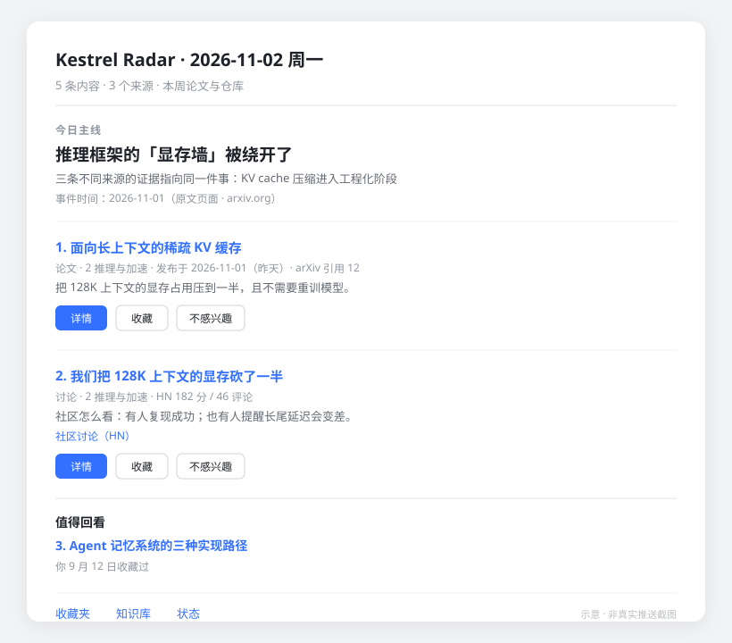
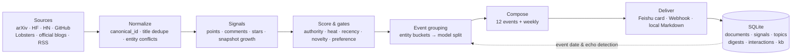

# Kestrel Radar

> **A radar that remembers what it already told you.**

[中文](README.md) · [English](README.en.md)

[](https://github.com/lieyukou1/kestrel-radar/actions/workflows/test.yml)
[](https://www.python.org/)
[](LICENSE)
[](https://sqlite.org/)

Kestrel Radar is a **local-first** AI intelligence system. It collects from arXiv, Hugging Face
Daily Papers, Hacker News, GitHub, Lobsters, official blogs and Chinese / overseas tech media,
then scores, folds reports of the same story into one event, de-duplicates and delivers a digest
to Feishu (two-level interactive cards: events first, articles on tap) or any webhook.

The difference is not collection — it is **memory**. The same story does not get pushed twice
because it changed its title or arrived two days late. A topic that genuinely made progress
does get pushed again.

---

## Why

AI news does not lack aggregators. It lacks three things:

1. **Memory.** A model release appears on arXiv, Hacker News, a newsletter and GitHub. Most
   aggregators treat those as four separate stories and send you four messages; the next day
   a reworded version appears and you get it again.
2. **Time sense.** Publish time is not event time. A three-day-old story being re-reported
   should not rank alongside today's breaking news.
3. **Closure.** Read-and-forget means you cannot find it again. Favorites become a landfill,
   not a knowledge base.

Kestrel Radar is built around those: **de-duplication at the entity level, ranking by how a
story fermented rather than when it was posted, and a full path from push to collection to
deep read to questions to comparison.**

## What it does

### 1. Multi-source collection with per-source cursors

| Type | Sources | Notes |
|---|---|---|
| Papers | arXiv, Hugging Face Daily Papers | abstracts and authors preserved |
| Community | Hacker News, Lobsters | points and comments as heat signals |
| Code | GitHub Search | stars plus **growth across snapshots** |
| First-party | OpenAI, DeepMind, Google AI, MSR, BAIR, NVIDIA, Apple ML, HF blogs | avoids second-hand paraphrase; own-product announcements are exempt from the promo filter |
| Chinese | QbitAI, InfoQ, GeekPark, Leiphone, Juejin, kexue.fm | keyword filter and age window |
| Overseas | The Decoder, TechCrunch AI | event-first ranking needs independent sources for coverage |
| Private | `config/domains/<id>/sources.local.yaml` | personal WeChat feeds, never committed |

Each source has its own cursor and failure domain; raw payloads are stored for replay.

### 2. Maturity window, five-factor scoring, momentum

- Maturity: papers 48h, forums 24h, repos 24h, blogs 12h.
- Weights: authority 0.30 / heat 0.30 / recency 0.15 / novelty 0.15 / preference 0.10.
- Heat = **65% static signal + 35% snapshot momentum** — a repo growing 22% per day maxes it out.
- GitHub gate: ≥200 stars, ≥3 observations, ≥1.5h span, ≥20 stars/day and ≥1% per day.

### 3. Event first: events on level one, articles on level two

Vector-threshold clustering is gone: two different stories about one entity score 0.79
(Fable 5.2 vs Opus 5.5) while two reports of one story in different languages score 0.63 —
no threshold satisfies both. Instead:

1. coarse grouping by entity (including "name + version", e.g. Fable 5.2, Qwen3);
2. the model splits each bucket into "one thing" events and names them, falling back to
   one-bucket-one-event.

Event score = coverage 0.30 (sources + 0.5 × extra same-source articles) + item count 0.30 +
authority 0.20 + recency 0.10 + best item score 0.10. Blog / forum posts that no event claims
each become their own event (papers and repos are left to the weekly digest) and naturally sink
to the bottom — **so a day without a clear mainline still shows something**.

### 4. Echo detection: the core

Each topic stores the **event date** (not the publish date), inferred in this order:

```
explicit date in the material → structured date on the source page (published_time / datePublished)
→ external news search → earliest publish date among related materials (upper bound)
```

Follow-up coverage within three days is downgraded to a brief; only a real new version, feature
or conclusion may start a new topic. Without an event date it falls back to a 7-day window.
This is what separates "duplicate" from "progress".

When the inferred date is more than 30 days older than this round's materials, the earliest
report date of the round is shown instead (otherwise cards would say "last year"); the cost is
that re-reported old news may open a new mainline, bounded by the 30-day document dedupe. The
same event key within 7 days continues the thread and shows "day N / M new".

### 5. Three levels of reading

- **L1 event list**: the first card holds 12 events (title · article count · source count · day
  number · one-line takeaway · event date) with the mainline on top. Monday weekly is 3 papers +
  2 repos, ranked by fermented heat.
- **L2 event detail**: tapping "details" pulls every article of that event (max 6) with summary,
  source link, save / dislike. Mainline summaries are generated before the push, so no waiting.
- **L3 deep read**: background full-text fetch, structured extraction, knowledge-base entry, then
  a "deep read finished" message with motivation, method, evidence, limitations, relations and
  citation anchors.

### 6. Knowledge base

Only deep-read articles enter the KB. From there you can find related articles, compare two
articles, search around a topic, and ask questions grounded in the KB — when there is no
grounding, it says so instead of inventing an answer. Items saved or deep-read 30+ days ago
resurface at the end of a daily digest as "Worth revisiting" (60-day gap, at most twice each).

You can also send an article link directly (or `/read <url>`): it fetches the body, stores it,
deep-reads it and pushes the explanation when done. WeChat public-account articles work too;
if WeChat serves a verification page, you get the reason instead of a silent failure.

### 7. Feedback loop and dimension rotation

Save / dislike / "fewer like this" / set a temporary theme all feed back into preference weights.
Push dimensions rotate using an exposure-deficit multiplier, capped at ±20%, affecting only
tie-breaking order — never used to push obscure content just to fill a dimension.

## What a card looks like



> Structure illustration (a single card); level one is now an event list, and "details" opens the article list.

## How it compares

| | RSS reader | News aggregator | **Kestrel Radar** |
|---|---|---|---|
| Ranking | publish time | editorial / heat | authority + heat momentum + recency + novelty + preference |
| Dedup | link / title | title | canonical_id + title similarity + **entity conflicts** |
| Cross-day memory | none | weak | **event date + echo detection + read state** |
| Interaction loop | none | limited | save / deep read / ask / compare / negative feedback |
| Data location | cloud | cloud | **local SQLite, no telemetry** |
| Cost per item | 0 | subscription | LLM only for summaries, topic naming, deep reads, Q&A; daily budget cap |

Among open-source peers, [Horizon](https://github.com/Thysrael/Horizon) covers more sources and
[TrendRadar](https://github.com/sansan0/TrendRadar) covers more hot lists. Kestrel Radar's
difference is **single-user + local-first + event-level memory + a deep-reading loop** — not
collection breadth.

## Channels

| Channel | Command | Capabilities |
|---|---|---|
| Feishu | `serve --channel feishu` | interactive cards, button callbacks, natural-language commands |
| Webhook | `serve --channel webhook` | one-way; `generic / slack / discord / dingtalk / feishu` payloads |
| Local files | `serve --channel fake` | writes `data/domains/<id>/outbox/*.md`, no credentials needed |

The scheduler, deep-read worker and vector backfill are channel-agnostic. Adding a channel means
implementing one `Notifier`.

## Quick start

```bash
git clone https://github.com/lieyukou1/kestrel-radar.git
cd kestrel-radar
uv sync
cp .env.example .env          # set DEEPSEEK_API_KEY; Feishu or Webhook
uv run ai-radar init
uv run ai-radar collect
uv run ai-radar digest --channel fake     # inspect the generated Markdown first
```

Run as a service:

```bash
uv run ai-radar serve --channel fake      # no credentials: scheduled collect + Markdown
uv run ai-radar serve --channel webhook   # after setting AI_RADAR_WEBHOOK_URL
uv run ai-radar serve --channel feishu    # Feishu long connection + interactive cards
```

Feishu setup: create a self-built app with long-connection mode, put `FEISHU_APP_ID` and
`FEISHU_APP_SECRET` in `.env`, message the bot so it replies with its `open_id`, then set
`FEISHU_USER_OPEN_ID` and restart. The bot only answers that one account.

## Commands

| Command | Purpose |
|---|---|
| `init` | create the database |
| `config-check` | validate config and print a summary (no database writes) |
| `collect` | fetch all enabled sources |
| `digest --kind daily\|weekly` | build and deliver a digest (`--preview` to rehearse) |
| `run` | `collect` + `digest`, suitable for cron |
| `serve --channel feishu\|webhook\|fake` | scheduler, deep-read worker, vector backfill |
| `status [--format json\|table]` | documents, status distribution, last-7-day sources / cost / deliveries; `table` for a human-readable view |
| `favorites` / `prefs` | favorites / preferences |
| `search <query>` | search the whole library, fall back to the web |
| `related --document-id N` | related articles in the knowledge base |
| `compare --left N --right M` | side-by-side comparison |
| `deep-read --document-id N` | run one deep read synchronously |
| `interact --document-id N --action save` | simulate a card action locally |
| `test-push --channel fake` | send a test message |
| `feishu-info` | inspect the bot bound to current credentials |
| `backfill-vectors` | compute vectors for historical deep reads |

## Configuration

| File | Purpose |
|---|---|
| `config/domains/<id>/domain.yaml` | domain pack: taxonomy, keywords, entity/action vocab, prompt tone |
| `config/domains/<id>/sources.yaml` | sources, proxy, per-source limits, keyword filters |
| `config/domains/<id>/sources.local.yaml` | optional private sources, gitignored, merged at load time |
| `config/weights.yaml` | scoring weights, momentum, maturity windows, cadence |
| `config/models.yaml` | model names, pricing, daily budget |
| `.env` | credentials and runtime overrides (proxy, webhook) |

The proxy is empty by default; set `AI_RADAR_PROXY` when needed, so personal network settings
never enter the repo.

Data lives under `data/domains/<id>/` (database and outbox). Switch domains with `--domain <id>`
or `AI_RADAR_DOMAIN`; sources, prompts, and data stay isolated per domain. Two packs ship in the
repo: `ai` (default) and `finance`.

## Architecture



```
src/ai_radar/
├── jobs/       scheduler, collectors, deep-read worker, Feishu router
├── pipeline/   normalize, scoring, topics, compose, event time, echo
├── adapters/   sources, notifiers, web search, URL safety
├── llm/        DeepSeek client, prompts, budget control
└── store/      SQLite schema and repositories
```

## Key rules

| Rule | Value |
|---|---|
| Title dedupe (30-day window) | `token_set_ratio ≥ 90` |
| Same-day duplicate | `partial_ratio ≥ 75` and `ratio ≥ 50`, or cosine ≥ 0.95 |
| Entity conflict | only when both sides name a product; disjoint products / versions, or release vs incident → not merged |
| Pushed guard | documents and titles pushed in the last 30 days never re-enter candidates, even if their status is reset |
| Maturity | papers 48h / forums 24h / repos 24h / blogs 12h |
| Event grouping | entity buckets (96h window, ≤20 buckets) → model split; coverage = sources + 0.5× extra same-source articles |
| Event ranking | top 12 events per day; mainline needs ≥2 items; single-item events are included but rank low |
| Event date floor | inferred dates older than this round's materials by 30+ days are shown as the round's earliest report date |
| Echo | follow-up within 3 days of the event; 7-day fallback without event date |
| Cadence | collect every 30 min; Mon 10:00 weekly (3 papers + 2 repos); Tue–Fri 10:00 daily (12 events ≈ 30 articles); weekends off |
| Breaking insertion | HN ≥300 points / HF ≥120 upvotes / repo ≥500 stars per day |
| Dimension rotation | deficit multiplier capped at ±20%; 14-day cold start |
| Model budget | ¥5/day; deep reads pause at 80%, all calls stop at 100% |

## Design trade-offs

- **SQLite over Postgres**: single user, single machine, single file. Backup is a file copy.
- **No multi-tenancy**: it would drag in auth, quotas, audit and isolation, turning a personal
  assistant into a team product — out of scope.
- **No vector database**: brute-force search over tens of thousands of documents plus a small
  local model (bge-small-zh) is enough; one less service, one less failure mode.
- **Lobsters instead of Reddit**: Reddit's JSON/RSS now needs OAuth and returns 403/429;
  Lobsters is stable and the signal is cleaner, even if smaller.
- **Pluggable channels, not "every channel"**: make Feishu first-class, cover the rest with
  webhooks, instead of maintaining ten half-finished adapters.

## Known limits

- Single user: the bot serves one `open_id`; there is no permission model.
- Event dates are usually blank for non-mainline events (the split model rarely gives a date and
  only the mainline triggers the page-date lookup), so level one reliably shows a date for it only.
- Level one shows 12 events and any pushed document is deduped for 30 days, so a day consumes
  roughly 30 articles of candidates.
- Event dates are inferred and can be off by days; inference failure degrades to a window.
- Summaries, community points and deep-read conclusions are model-generated; the card is an
  entry point, not a source of truth.
- Lobsters' AI/ML tags are low-volume; community signal is supplementary.
- No cross-device sync; the database is the only source of truth.
- WeChat article bodies depend on a third-party transcoding service; if it breaks, that source
  stalls without affecting the others.

## Roadmap

- [ ] Telegram / email channels (the `Notifier` interface is already decoupled)
- [ ] MCP server: let Claude / Cursor read your local intelligence library
- [ ] Replace regex + word lists with a small entity-recognition model
- [ ] Weekly "topic evolution" view: a timeline of progress across weeks
- [ ] Coverage dashboard and finer collector contract tests

## Development

```bash
uv sync --dev
uv run ruff check .
uv run pytest -q        # 406 tests
```

Tests cover collector parsing, normalization and dedupe, entity conflicts, scoring and event
grouping, echo detection, card rendering, channel retries, budget degradation and URL safety.
GitHub Actions runs ruff and the full suite on Python 3.12 and 3.13.

## Security

- Outbound fetches validate URLs: http/https only; localhost, private, link-local and reserved
  addresses are rejected (SSRF protection).
- Card titles are Markdown-escaped and links must be http(s) (injection protection).
- `open_id` is redacted in logs.
- Credentials come from environment variables only; `.env`, databases and logs are never committed.
- Reporting: see [SECURITY.md](SECURITY.md).

## License

MIT. See [LICENSE](LICENSE).
