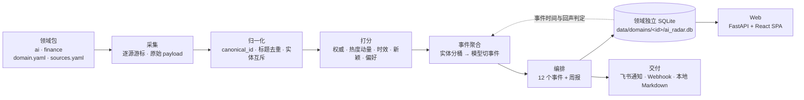

# Kestrel Radar

> **A radar that remembers what it already told you.**
> 本地优先的多领域资讯雷达：把同一件事收成一个事件，并记住自己说过什么。

[中文](README.md) · [English](README.en.md)

[](https://github.com/lieyukou1/kestrel-radar/actions/workflows/test.yml)
[](https://www.python.org/)
[](LICENSE)
[](https://sqlite.org/)

Kestrel Radar 是一个跑在本机的资讯雷达。它按**领域包**采集信源，做标题与实体级去重、五维打分，
把同一件事的多篇报道收成一个**事件**，再通过两个出口交付：

- **Web 阅读界面**：日报、事件、文章详情、知识库、问答、状态、设置；
- **通知渠道**：默认飞书只发一条带网页链接的通知，也支持完整卡片、Webhook 或本地 Markdown。

仓库内置两个领域包：`ai`（AI 观察）与 `finance`（金融市场观察）。采集、打分、事件聚合、
回声判定与精读共用同一套流水线，换领域只需要换 `config/domains/<id>/` 下的配置；每个领域
使用独立 SQLite，数据、信源、提示词互不污染。

它和大多数资讯聚合器的区别不在采集数量，而在**记忆**：同一个事件不会因为换了标题、晚了两天
就被重复推送；真的出现新进展时，它也能认出来并继续跟踪。

---

## 目录

- [现在的形态](#现在的形态)
- [为什么需要它](#为什么需要它)
- [核心能力](#核心能力)
- [交付渠道](#交付渠道)
- [快速开始](#快速开始)
- [命令一览](#命令一览)
- [配置](#配置)
- [Web 界面](#web-界面)
- [Web API](#web-api)
- [架构](#架构)
- [关键规则](#关键规则)
- [设计取舍](#设计取舍)
- [已知边界](#已知边界)
- [Roadmap](#roadmap)
- [开发](#开发)
- [安全](#安全)
- [License](#license)

---

## 现在的形态

| 维度 | 现在的做法 |
|---|---|
| 领域 | 领域包可插拔；内置 `ai` / `finance`；`--domain` 或 `AI_RADAR_DOMAIN` 切换 |
| 数据 | 每个领域一个 SQLite：`data/domains/<id>/ai_radar.db` |
| 主界面 | React Web：日报、归档、知识库、问答、状态、设置，以及独立文章详情页 |
| 交付 | 默认飞书只发一条带网页链接的通知；完整卡片 / Webhook / 本地 Markdown 可选 |
| 自动化 | CLI 保留 `collect` / `digest` / `serve` / `api`，可 cron，也可常驻 |
| 导出 | 日报可导出 Markdown / JSON；设置页可下载当前领域的整库备份 |

## 为什么需要它

信息不缺「聚合」，缺三样东西：

1. **记忆**。同一条消息，通讯社会有一版、社区会有一帖、公众号会有一篇、官网会有公告。
   大多数聚合器把它们当成四条新闻，一天发你四遍；第二天换个标题，再发一遍。
2. **时间感**。新闻的「发布时间」不等于事件的「发生时间」。一篇三天后才被转述的旧闻，
   不该和今天的突发排在一起。
3. **收口**。读完就散，下次要用时想不起来在哪看过。收藏夹变成垃圾场，而不是知识库。

Kestrel Radar 围绕这三点做的：**去重不是字符串匹配，是实体级的互斥判断；排序不看发布时间，
看事件的发酵程度；推送不是终点，收藏、精读、反问、对比都在同一条链路上。**

## 核心能力

### 1. 领域包：一套流水线，多个领域

每个领域是 `config/domains/<id>/` 下的一个包：

```
config/domains/<id>/
├── domain.yaml          # 分类、关键词、实体/动作词、提示词、领域级权重覆盖
├── sources.yaml         # 信源、代理、单源上限、关键词过滤
└── sources.local.yaml   # 可选，私有信源，不入库，加载时与上者合并
```

内置两个领域：

| 领域包 | 分类 | 信源 | 领域级覆盖 |
|---|---|---|---|
| `ai` | 8 类：模型与架构、训练与对齐、推理与加速、Agent 与应用、多模态与生成、系统与基础设施、理论与可解释性、数据与评测 | arXiv、HF Daily、Hacker News、GitHub、Lobsters、8 个官方博客、6 个中文技术媒体、2 个海外 AI 媒体 | 全局默认权重，96h 事件窗 |
| `finance` | 8 类：宏观经济、货币政策、市场与行情、公司财报与交易、监管与合规、金融科技与加密、银行与信贷、全球贸易与地缘 | 华尔街见闻、CNBC、MarketWatch、FT、Economist、BBC、Guardian、NYT，以及 Fed / SEC / ECB | 权威 0.35 + 时效 0.25，热度降到 0.10；2h 成熟窗口；48h 事件窗 |

领域之间完全隔离：

```bash
uv run ai-radar --domain finance collect
uv run ai-radar --domain finance digest --channel fake --preview
```

数据落 `data/domains/<id>/`，库里只存本领域的内容；删掉一个领域目录，就等于彻底卸载这个领域。

### 2. 采集、成熟窗口与打分

内容不是一抓到就推，而是先「发酵」：

- 默认成熟窗口：论文 48h、论坛 24h、仓库 24h、博客 12h；财经领域统一压到 2h。
- 默认五维权重：权威 0.30 / 热度 0.30 / 时效 0.15 / 新颖 0.15 / 个人偏好 0.10。
- 热度不是静态分数，而是 **65% 静态信号 + 35% 快照增速**：一天涨 22% 的仓库才算满分动量。
- GitHub 双层闸门：≥200 星，且至少 3 次观测、跨度 ≥1.5h、日增 ≥20 星且 ≥1%，四个条件同时满足。

每个来源独立游标、独立失败，单源挂掉不影响其他源；原始 payload 全量落库，可回溯、可重放。

### 3. 事件优先：一级看「事」，二级看「篇」

不再用向量阈值聚簇：同一实体的两件不同事相似度能到 0.79（Fable 5.2 vs Opus 5.5），
同一件事的中英两篇报道只有 0.63，不存在同时成立的阈值。改成两步：

1. 按实体粗分组（含「名称 + 版本号」，Fable 5.2、Qwen3 这类）；
2. 模型把每个桶切成「一件事」并命名，失败时退回「一桶一件事」。

事件分 = 覆盖度 0.30（来源数 + 0.5×同源额外篇数）+ 条数 0.30 + 权威 0.20 + 新鲜度 0.10 +
单篇最高分 0.10。没被任何事件收留的博客 / 论坛帖也各自成事件（论文和仓库留给周报），
分数天然低、排在末尾——**即使当天聚不出主线，也不会一篇文章都看不到**。

### 4. 回声判定：这套系统的核心

每个话题记录**事件发生时间**（不是材料发布时间），推断顺序是：

```
材料正文中的明确日期 → 原文页面的结构化发布日期（published_time / datePublished）
→ 外部新闻检索 → 该主线关联材料的最早发布日期（上界兜底）
```

三天以内的跟进报道降级成快讯；只有真正的新版本、新功能、新结论才允许再次开主线；
没有事件时间时退化为 7 天窗口。这一层让「重复」和「进展」第一次被区分开。

推断时间比本轮材料还早 30 天以上时，按本轮最早报道日显示（否则卡片上会出现「去年的事」）；
代价是旧闻被重新报道时可能重开主线，靠 30 天文档去重兜底。同一个事件键 7 天内命中即跨天续跟，
卡片上标「第 N 天 / 新增 M 条」。

### 5. Web 阅读与精读

- **L1 事件列表**：日报只放 12 个事件（标题 · 几条报道 · 第几天 · 一句话结论 · 事件时间），
  主线置顶；周报是 3 篇论文 + 2 个仓库，按发酵后的热度排序。
- **L2 文章详情**：事件展开后看该事件下的文章，点标题进入独立文章页；正文、摘要、知识卡片、
  来源、出现记录都在同一页。
- **L3 精读**：后台抓全文、结构化抽取、入库；文章页显示排队状态，完成后自动刷新出知识卡片。
  内容包括问题、方法、证据、结论、局限、工程解读与原文引用位置。

日报页可以把当期导出为 Markdown（API 同时支持 JSON）；设置页可以下载当前领域的整库备份。领域下拉会显示
每个领域最近一期日报的日期。

### 6. 知识库与问答

精读完成才入库。入库后可以：找相关文章、两篇横向对比、围绕某话题继续检索、
让模型基于知识库回答问题（没有依据时会明确说「没有依据」，不会硬编）。
收藏或精读过满 30 天的内容会进入回看候选，在日报末尾以「值得回看」出现一次
（同一条间隔 ≥60 天、累计最多 2 次）。

也可以把文章链接直接发给机器人（或 `/read <链接>`）：它会抓正文、入库、精读，完成后推送
深度讲解。公众号文章同样支持；遇到微信风控验证页会明确告诉你失败原因，而不是静默失败。

### 7. 反馈闭环与维度轮转

收藏 / 不感兴趣 / 少推这类 / 设定主题，都会回流成偏好权重。
推送维度用「曝光赤字」做轮转：连续推了三次推理加速，下一次同分时优先让位给别的方向，
乘子封顶 ±20%，只影响同分条目的先后，不会为了补维度去推冷门。

## 交付渠道

| 渠道 | 命令 | 能力 |
|---|---|---|
| 飞书通知（默认） | `serve --channel feishu-notice` | 只发一条带网页链接的摘要；长连接与卡片交互保留 |
| 飞书完整卡片 | `serve --channel feishu` | 完整事件卡片 + 按钮回调（旧行为，仍可用） |
| 不投递 | `serve --channel none` | 只生成写库，网页查看 |
| Webhook | `serve --channel webhook` | 单向推送；支持 `generic / slack / discord / dingtalk / feishu` |
| 本地文件 | `serve --channel fake` | 写到 `data/domains/<id>/outbox/*.md`，无凭据试跑与调试 |

调度器、精读 worker、向量回填与渠道完全解耦；加新渠道只需要实现一个 `Notifier`，
不用碰流水线。

## 快速开始

需要 Python 3.12+、[uv](https://docs.astral.sh/uv/)，以及构建网页用的 Node.js 20+。

```bash
git clone https://github.com/lieyukou1/kestrel-radar.git
cd kestrel-radar
uv sync

cd web && npm install && npm run build && cd ..
# 构建产物在 web/dist，api 启动时自动托管

cp .env.example .env          # 填 DEEPSEEK_API_KEY；飞书 / Webhook 可选
uv run ai-radar init
uv run ai-radar collect
uv run ai-radar digest --channel fake --preview   # 先在 outbox 里看 Markdown

uv run ai-radar api --port 8765
# 打开 http://127.0.0.1:8765/
```

常驻运行：

```bash
uv run ai-radar serve --channel feishu-notice   # 默认：定时采集 + 精读 worker + 飞书通知
uv run ai-radar serve --channel none            # 只维护数据，阅读全部走网页
uv run ai-radar serve --channel webhook         # 配好 AI_RADAR_WEBHOOK_URL 后使用
uv run ai-radar serve --channel feishu          # 飞书长连接 + 完整交互卡片
```

飞书接入（自建应用，长连接模式）：

1. 在开放平台创建企业自建应用，开启「长连接」与消息、卡片权限；
2. `.env` 填 `FEISHU_APP_ID` / `FEISHU_APP_SECRET`；
3. 给机器人发一条消息，它会把自己的 `open_id` 回给你；
4. 填进 `FEISHU_USER_OPEN_ID`，重启。机器人只响应这一个账号。

## 命令一览

所有命令都支持全局参数 `--domain <id>`（放在子命令前），默认 `ai`，也可用 `AI_RADAR_DOMAIN` 指定。

| 命令 | 作用 |
|---|---|
| `init` | 初始化当前领域的数据库（建表、写 meta） |
| `config-check` | 校验配置并输出摘要（不写数据库） |
| `collect` | 拉取当前领域所有启用来源 |
| `digest --kind daily\|weekly` | 生成并投递当期内容（`--preview` 预演，`--channel` 选渠道） |
| `run` | `collect` + `digest`，适合 cron |
| `serve --channel feishu-notice\|feishu\|none\|webhook\|fake` | 常驻：定时采集、精读 worker、向量回填；默认飞书通知 |
| `api --host 127.0.0.1 --port 8765` | 启动本地 Web API（FastAPI），同源托管网页 |
| `status [--format json\|table]` | 文档数、状态分布、最近 7 天的源/花费/推送；`table` 输出人读表格 |
| `favorites` / `prefs` | 收藏夹 / 偏好设置 |
| `search <query>` | 全库检索，本地不足时补站外 |
| `related --document-id N` | 找知识库里的相关文章 |
| `compare --left N --right M` | 两篇横向对比 |
| `deep-read --document-id N` | 同步执行一次精读（补跑 / 验证） |
| `interact --document-id N --action save` | 本地模拟一次卡片动作 |
| `test-push --channel fake` | 发一条测试消息，验证渠道配置 |
| `feishu-info` | 查看当前凭据对应的机器人信息 |
| `backfill-vectors` | 为历史精读文章补算语义向量 |

## 配置

| 文件 | 作用 |
|---|---|
| `config/domains/<id>/domain.yaml` | 领域包：分类、关键词、实体/动作词、提示词语气、领域级权重覆盖 |
| `config/domains/<id>/sources.yaml` | 信源、代理、单源上限、关键词过滤 |
| `config/domains/<id>/sources.local.yaml` | 可选，本地私有信源，不入库，加载时与上者合并 |
| `config/weights.yaml` | 全局打分权重、热度动量、成熟窗口、推送节奏 |
| `config/models.yaml` | 模型名、单价、每日预算 |
| `.env` | 凭据与运行期覆盖（代理、Webhook、默认领域、网页地址） |

常用环境变量：

| 变量 | 作用 |
|---|---|
| `DEEPSEEK_API_KEY` | 摘要、主线命名、精读、问答所需的模型凭据 |
| `AI_RADAR_DOMAIN` | 默认领域包 id，默认 `ai` |
| `AI_RADAR_PROXY` | 抓取代理；留空表示直连 |
| `AI_RADAR_WEB_URL` | 通知里附带的网页地址，默认 `http://127.0.0.1:8765` |
| `FEISHU_APP_ID` / `FEISHU_APP_SECRET` / `FEISHU_USER_OPEN_ID` | 飞书自建应用凭据与唯一接收人 |
| `AI_RADAR_WEBHOOK_URL` / `AI_RADAR_WEBHOOK_FORMAT` / `AI_RADAR_WEBHOOK_PROXY` | Webhook 地址、格式与单独代理 |

代理默认留空（直连），需要时用 `AI_RADAR_PROXY` 覆盖，不把个人网络配置写进仓库。

## Web 界面

网页端在 `web/`（React 19 + Vite + TanStack Query + Tailwind），构建后由 `api` 同源托管：

| 页面 | 内容 |
|---|---|
| 日报 | 事件列表（12 个事件）、日期切换、导出 Markdown |
| 归档 | 全时间范围检索与筛选，不受新鲜度影响 |
| 知识库 | 已精读 / 已收藏内容，进入完整知识卡片 |
| 问答 | 基于知识库的检索问答，没有依据时明确说「没有依据」 |
| 状态 | 文档分布、最近任务、采集与模型花费 |
| 设置 | 暂停分类 / 信源、偏好权重、下载数据库备份 |
| 文章详情 | 独立页面 `/articles/{id}`：正文、精读状态、知识卡片、来源、出现记录 |

右上角切换领域，下拉里会显示各领域最近一期日报日期。开发期用 `npm run dev`
（5173 端口，`/api` 自动代理到 8765）。

飞书默认只发一条通知，链接由 `AI_RADAR_WEB_URL` 决定；需要继续推完整卡片时用
`serve --channel feishu`。

## Web API

`uv run ai-radar api` 在 `127.0.0.1:8765` 起一个本地 API，OpenAPI 文档在 `/docs`，
所有接口都接受 `?domain=ai|finance`。

| 分组 | 端点 |
|---|---|
| 领域 | `GET /api/v1/domains`、`GET /api/v1/domains/{id}` |
| 日报 | `GET /api/v1/digests`、`GET /api/v1/digests/{date}` |
| 事件 | `GET /api/v1/events?date=`、`GET /api/v1/events/{id}` |
| 文章 | `GET /api/v1/articles/{id}`、`POST /api/v1/articles/{id}/actions` |
| 归档/检索 | `GET /api/v1/archive`、`GET /api/v1/search` |
| 知识库 | `GET /api/v1/kb` |
| 问答/设置 | `POST /api/v1/qa`、`GET/PUT /api/v1/settings` |
| 任务 | `GET /api/v1/jobs`、`POST /api/v1/jobs/collect`、`POST /api/v1/jobs/digest`、`GET /api/v1/status` |
| 导出/备份 | `GET /api/v1/export/digest/{date}?format=markdown\|json`、`GET /api/v1/export/backup` |

网页触发日报默认 `channel=fake`、`preview=true`（只落 outbox），不会误推飞书。

## 架构



```
config/domains/<id>/   领域包：分类、信源、提示词、权重覆盖
data/domains/<id>/     领域数据：ai_radar.db、outbox/
src/ai_radar/
├── api/        FastAPI 路由、序列化、静态托管
├── domain/     领域包加载与校验
├── jobs/       调度、采集、精读 worker、飞书路由
├── pipeline/   归一化、打分、事件、编排、事件时间、回声、检索
├── adapters/   信源、通知渠道、站外检索、URL 安全校验
├── llm/        DeepSeek 客户端、提示词、预算控制
└── store/      SQLite schema 与 repository
web/           React 19 + Vite + TanStack Query + Tailwind
```

## 关键规则

| 规则 | 取值 |
|---|---|
| 标题去重（30 天窗口） | `token_set_ratio ≥ 90` |
| 当日重复判定 | `partial_ratio ≥ 75` 且 `ratio ≥ 50`，或向量余弦 ≥ 0.95 |
| 实体互斥 | 双方都有产品实体才判；产品不相交 / 同产品版本不相交 / 发布与事故互斥 → 不合并 |
| 已推送避让 | 30 天内推过的文档与标题不再进候选，即使状态被手动回退也不会重复推 |
| 成熟窗口 | 默认论文 48h / 论坛 24h / 仓库 24h / 博客 12h；财经领域统一 2h |
| 事件聚合 | 实体粗分组（默认 96h 窗口、最多 20 桶；财经 48h）→ 模型切事件；覆盖度 = 来源数 + 0.5×同源额外篇数 |
| 事件入榜 | 一级取分数前 12 个事件；主线要求 ≥2 篇；单篇事件也入列表，分数低自然靠后 |
| 事件时间下界 | 推断值早于本轮材料 30 天以上时，按本轮最早报道日显示 |
| 回声阈值 | 事件时间 3 天内跟进降级；无事件时间退化 7 天 |
| 推送节奏 | 每 30 分钟采集；周一 10:00 周报（3 论文 + 2 仓库）；周二~周五 10:00 日报（12 个事件 ≈ 30 篇文章）；周末不推 |
| 爆款插队 | HN ≥300 分 / HF ≥120 赞 / 仓库日增 ≥500 星 |
| 维度轮转 | 曝光赤字乘子封顶 ±20%，冷启动 14 天不调整 |
| 模型预算 | 每日 5 元；用到 80% 暂停精读，100% 停止调用 |

## 设计取舍

- **领域包，而不是 fork**：采集、打分、事件、回声、精读都是领域无关的；领域差异收敛到分类词表、
  信源、提示词和少量权重覆盖。新增领域不应该复制一套代码。
- **每个领域一个库，而不是一个库加 domain 列**：隔离彻底，备份和删除都是目录级操作；
  领域之间也不会互相污染游标、偏好与事件记忆。
- **Web 为主界面，飞书降级为通知**：事件列表、文章详情、知识卡片需要空间；卡片适合提醒，
  不适合长期阅读。飞书完整卡片仍然保留，但不再是默认交付方式。
- **事件而不是文章作为推送单位**：单篇排序会被转载和同题报道稀释；按事件打分才能反映
  「今天真正发生了什么」。
- **SQLite 而不是 Postgres**：单用户、单机、单文件。备份就是拷一个文件，删掉就是彻底卸载。
- **不做多用户**：一旦多租户，鉴权、配额、审计、数据隔离全要补，产品假设就从「个人情报助手」
  变成了「团队协作工具」，这不是本项目要解决的问题。
- **不引入向量数据库**：几万条文档的暴力检索 + 本地小模型（bge-small-zh）足够，少一个服务就少一个故障点。

## 已知边界

- 单人使用：默认只监听 `127.0.0.1`，没有登录与多用户权限体系；不要把 API 直接暴露到公网。
- 领域包不是零配置：新增领域仍要维护分类词表、信源、实体/动作词和提示词。
- 非主线事件的事件时间多数为空（切分模型没给具体日期，只有主线会走原文日期回查），
  一级卡片上通常只有主线稳定显示时间。
- 一级只展示 12 个事件，入选即按文档去重 30 天，一天大约消耗 30 篇文章的候选。
- 事件时间靠三档推断，可能差几天；推断失败会退化成窗口判定。
- 摘要、社区观点、精读结论由模型生成，可能出错；卡片与文章页是入口，不是事实来源。
- Lobsters 的 AI/ML 标签下帖子量不大，社区信号只能算补充。
- 不做跨设备同步，数据库就是唯一事实；备份是整库快照，不包含逐条合并。
- 公众号正文抓取依赖第三方转码服务，上游挂了该源就断更（不影响其他源）。

## Roadmap

- [ ] 更多领域包（政策、生物医药、能源），并把领域包做成可安装的目录规范
- [ ] Telegram / 邮件渠道（`Notifier` 已解耦，只差实现）
- [ ] MCP server：让 Claude / Cursor 直接读取你的本地情报库
- [ ] 实体识别换成小模型，替代当前的正则 + 词表
- [ ] 周报的「主题演化」视图：同一话题跨周的进展时间线

## 开发

```bash
uv sync --dev
uv run ruff check .
uv run pytest -q        # 434 项后端测试

cd web
npm run test -- --run   # 17 项前端测试
npm run build
```

测试覆盖采集解析、归一化与去重、实体互斥、打分与事件聚合、回声判定、领域包加载、API、
导出与备份、卡片渲染、渠道重试、预算降级、URL 安全校验等；GitHub Actions 在 push / PR 时
跑全量测试。

## 安全

- 出站抓取校验 URL：仅 http/https，拒绝 localhost、私网、链路本地与保留地址（防 SSRF）。
- 卡片标题做 Markdown 转义，链接仅允许 http(s)（防注入）。
- 日志中的 `open_id` 脱敏。
- 凭据只从环境变量读取，`.env`、数据库、日志均不入库。
- 漏洞报告方式见 [SECURITY.md](SECURITY.md)。

## License

MIT。见 [LICENSE](LICENSE)。
