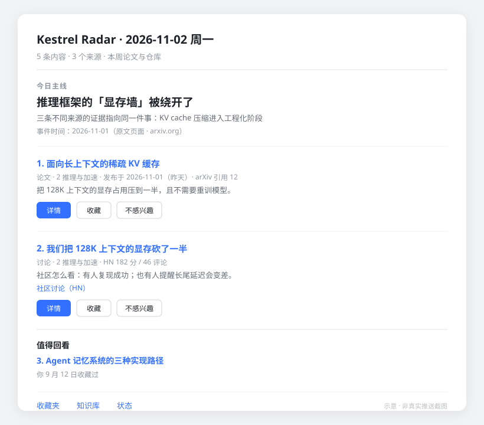
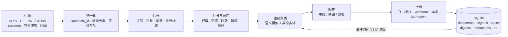

# Kestrel Radar

> **A radar that remembers what it already told you.**
> 会记住自己说过什么的 AI 情报雷达。

[中文](README.md) · [English](README.en.md)

[](https://github.com/lieyukou1/kestrel-radar/actions/workflows/test.yml)
[](https://www.python.org/)
[](LICENSE)
[](https://sqlite.org/)

Kestrel Radar 是一个**本地优先**的 AI 情报系统。它从 arXiv、Hugging Face Daily、Hacker News、
GitHub、Lobsters、官方博客和中文技术媒体采集内容，打分、聚主线、去重，然后按你的节奏推到飞书
（可交互卡片）或任意 Webhook。

它和大多数「AI 新闻聚合器」的区别不在采集，而在**记忆**：同一条新闻不会因为换了标题、晚了两天
就被重复推送；同一个话题真的出现了新进展，它也能认出来再推一次。

---

## 目录

- [为什么需要它](#为什么需要它)
- [它做了什么](#它做了什么)
- [一张卡片长什么样](#一张卡片长什么样)
- [和别的方案比](#和别的方案比)
- [推送渠道](#推送渠道)
- [快速开始](#快速开始)
- [命令一览](#命令一览)
- [配置](#配置)
- [架构](#架构)
- [关键规则](#关键规则)
- [设计取舍](#设计取舍)
- [已知边界](#已知边界)
- [Roadmap](#roadmap)
- [开发](#开发)
- [安全](#安全)
- [License](#license)

---

## 为什么需要它

2026 年的 AI 资讯不缺「聚合」，缺三样东西：

1. **记忆**。同一条模型发布，arXiv 会有一版、HN 会有一帖、公众号会有一篇、GitHub 会有仓库。
   绝大多数聚合器把它们当成四条新闻，一天推你四遍；第二天换个标题，再推一遍。
2. **时间感**。新闻的「发布时间」不等于事件的「发生时间」。一篇三天后才被转述的旧闻，
   不该和今天的突发排在一起。
3. **收口**。读完就散，下次要用时想不起来在哪看过。收藏夹变成垃圾场，而不是知识库。

Kestrel Radar 围绕这三点做的：**去重不是字符串匹配，是实体级的互斥判断；排序不看发布时间，
看事件的发酵程度；推送不是终点，收藏、精读、反问、对比都在同一条链路上。**

## 它做了什么

### 1. 多源采集，逐源游标

| 类型 | 来源 | 说明 |
|---|---|---|
| 论文 | arXiv、Hugging Face Daily Papers | 按分类拉取，保留摘要与作者 |
| 社区 | Hacker News、Lobsters | 点赞 / 评论数作为热度信号 |
| 代码 | GitHub Search | 星数与**多次快照的增速**，避免老仓库反复冒头 |
| 一手 | OpenAI、DeepMind、NVIDIA、Apple ML、HF 官方博客 | 独立成源，避免二手转述替官方说话 |
| 中文 | 量子位、InfoQ、极客公园、雷锋网、掘金、科学空间 | 标题 AI 关键词过滤 + 时效窗口 |
| 私有 | `config/sources.local.yaml` | 公众号等个人订阅源，不入库 |

每个来源独立游标、独立失败，单源挂掉不影响其他源；原始 payload 全量落库，可回溯、可重放。

### 2. 成熟窗口 + 五维打分 + 动量

内容不是一抓到就推，而是先「发酵」：

- 成熟窗口：论文 48h、论坛 24h、仓库 24h、博客 12h。
- 五维加权：权威 0.30 / 热度 0.30 / 时效 0.15 / 新颖 0.15 / 个人偏好 0.10。
- 热度不是静态分数，而是 **65% 静态信号 + 35% 快照增速**：一天涨 22% 的仓库才算满分动量。
- GitHub 双层闸门：≥200 星，且至少 3 次观测、跨度 ≥1.5h、日增 ≥20 星且 ≥1%，四个条件同时满足。

### 3. 主线聚类：推「事」，不推「篇」

候选池里做语义聚类，同一件事的不同角度（论文 / 讨论 / 媒体）会折叠成一条主线。
只共享一个实体不够——还要语义相似度过线；出现频率过高的泛实体（公司名之类）直接不作为话题键。
**聚不出主线就不硬凑**，当天只发快讯，并在卡片上明说。

### 4. 回声判定：这套系统的核心

每个话题记录**事件发生时间**（不是材料发布时间），推断顺序是：

```
材料正文中的明确日期 → 原文页面的结构化发布日期（published_time / datePublished）
→ 外部新闻检索 → 该主线关联材料的最早发布日期（上界兜底）
```

三天以内的跟进报道降级成快讯；只有真正的新版本、新功能、新结论才允许再次开主线；
没有事件时间时退化为 7 天窗口。这一层让「重复」和「进展」第一次被区分开。

### 5. 三级阅读

- **L1 每日推送**：主线 2~3 条 + 快讯 1~2 条；周报是 3 篇论文 + 2 个仓库，按发酵后的热度排序。
- **L2 文章详情**：问题 / 方法 / 结论的结构化摘要，点开即看（摘要推送前已生成，不产生等待）。
- **L3 精读**：后台抓全文、结构化抽取、入库，完成后主动推一条「精读完成」；
  内容包括动机、方法、证据、局限、与已入库文章的关系、原文引用位置。

### 6. 知识库

精读完成才入库。入库后可以：找相关文章、两篇横向对比、围绕某话题继续检索、
让模型基于知识库回答问题（没有依据时会明确说「没有依据」，不会硬编）。
收藏或精读过满 30 天的内容会进入回看候选，在日报末尾以「值得回看」出现一次
（同一条间隔 ≥60 天、累计最多 2 次）。

也可以把文章链接直接发给机器人（或 `/read <链接>`）：它会抓正文、入库、精读，完成后推送
深度讲解。公众号文章同样支持；遇到微信风控验证页会明确告诉你失败原因，而不是静默失败。

### 7. 反馈闭环与维度轮转

收藏 / 不感兴趣 / 少推这类 / 设定主题，都会回流成偏好权重。
推送维度用「曝光赤字」做轮转：连续推了三次推理加速，下一次同分时优先让位给别的方向，
乘子封顶 ±20%，只影响同分条目的先后，不会为了补维度去推冷门。

## 一张卡片长什么样



> 结构与真实推送一致，标题为示例，非真实内容。

## 和别的方案比

| | RSS 阅读器 | 通用新闻聚合 | **Kestrel Radar** |
|---|---|---|---|
| 排序依据 | 发布时间 | 编辑 / 热度 | 权威 + 热度动量 + 时效 + 新颖 + 个人偏好 |
| 去重 | 链接 / 标题 | 标题 | canonical_id + 标题相似度 + **实体互斥** |
| 跨天记忆 | 无 | 弱 | **事件时间 + 回声判定 + 已读状态** |
| 交互闭环 | 无 | 少 | 收藏 / 精读 / 反问 / 对比 / 负反馈 |
| 数据位置 | 云端 | 云端 | **本机 SQLite，无遥测** |
| 单条成本 | 0 | 订阅费 | 只在摘要、主线命名、精读、问答时调模型，日预算可设上限 |

同类开源项目里，[Horizon](https://github.com/Thysrael/Horizon) 的信源广度和
[TrendRadar](https://github.com/sansan0/TrendRadar) 的热榜覆盖都比本项成熟；
Kestrel Radar 的差异点是「单用户 + 本地优先 + 事件级记忆 + 深阅读闭环」，而不是采集数量。

## 推送渠道

| 渠道 | 命令 | 能力 |
|---|---|---|
| 飞书 | `serve --channel feishu` | 交互卡片、按钮回调、自然语言指令（一等公民） |
| Webhook | `serve --channel webhook` | 单向推送；支持 `generic / slack / discord / dingtalk / feishu` |
| 本地文件 | `serve --channel fake` | 写到 `data/outbox/*.md`，无凭据试跑与调试 |

调度器、精读 worker、向量回填与渠道完全解耦；加新渠道只需要实现一个 `Notifier`，
不用碰流水线。

## 快速开始

```bash
git clone https://github.com/lieyukou1/kestrel-radar.git
cd kestrel-radar
uv sync
cp .env.example .env          # 填 DEEPSEEK_API_KEY；飞书 / Webhook 二选一
uv run ai-radar init
uv run ai-radar collect
uv run ai-radar digest --channel fake     # 先在本地看生成的 Markdown
```

常驻运行：

```bash
uv run ai-radar serve --channel fake      # 无凭据：定时采集 + 生成 Markdown
uv run ai-radar serve --channel webhook   # 配好 AI_RADAR_WEBHOOK_URL 后使用
uv run ai-radar serve --channel feishu    # 飞书长连接 + 交互卡片
```

飞书接入（自建应用，长连接模式）：

1. 在开放平台创建企业自建应用，开启「长连接」与消息、卡片权限；
2. `.env` 填 `FEISHU_APP_ID` / `FEISHU_APP_SECRET`；
3. 给机器人发一条消息，它会把自己的 `open_id` 回给你；
4. 填进 `FEISHU_USER_OPEN_ID`，重启。机器人只响应这一个账号。

## 命令一览

| 命令 | 作用 |
|---|---|
| `init` | 初始化数据库（建表、写 meta） |
| `config-check` | 校验配置并输出摘要（不写数据库） |
| `collect` | 拉取所有启用来源 |
| `digest --kind daily\|weekly` | 生成并投递当期内容（`--preview` 预演） |
| `run` | `collect` + `digest`，适合 cron |
| `serve --channel feishu\|webhook\|fake` | 常驻：定时采集、精读 worker、向量回填 |
| `status [--format json\|table]` | 文档数、状态分布、最近 7 天的源/花费/推送；`table` 输出人读表格 |
| `favorites` / `prefs` | 收藏夹 / 偏好设置 |
| `search <query>` | 全库检索，本地不足时补站外 |
| `related --document-id N` | 找知识库里的相关文章 |
| `compare --left N --right M` | 两篇横向对比 |
| `deep-read --document-id N` | 同步执行一次精读（补跑 / 验证） |
| `interact --document-id N --action save` | 本地模拟一次卡片动作 |
| `test-push --channel fake` | 发一条测试消息，验证渠道配置 |
| `feishu-info` | 查看当前凭据对应的机器人信息 |
| `backfill-vectors` | 为历史精读文章补算语义向量 |

## 配置

| 文件 | 作用 |
|---|---|
| `config/sources.yaml` | 信源、代理、单源上限、关键词过滤 |
| `config/sources.local.yaml` | 可选，本地私有信源，不入库，加载时与上者合并 |
| `config/weights.yaml` | 打分权重、热度动量、成熟窗口、推送节奏 |
| `config/models.yaml` | 模型名、单价、每日预算 |
| `.env` | 凭据与运行期覆盖（代理、Webhook） |

代理默认留空（直连），需要时用 `AI_RADAR_PROXY` 覆盖，不把个人网络配置写进仓库。

## 架构



```
src/ai_radar/
├── jobs/       调度、采集、精读 worker、飞书路由
├── pipeline/   归一化、打分、话题、编排、事件时间、回声判定
├── adapters/   信源、通知渠道、站外检索、URL 安全校验
├── llm/        DeepSeek 客户端、提示词、预算控制
└── store/      SQLite schema 与 repository
```

## 关键规则

| 规则 | 取值 |
|---|---|
| 标题去重（30 天窗口） | `token_set_ratio ≥ 90` |
| 当日重复判定 | `partial_ratio ≥ 75` 且 `ratio ≥ 50`，或向量余弦 ≥ 0.95 |
| 实体互斥 | 双方都有产品实体才判；产品不相交 / 同产品版本不相交 / 发布与事故互斥 → 不合并 |
| 已推送避让 | 30 天内推过的文档与标题不再进候选，即使状态被手动回退也不会重复推 |
| 成熟窗口 | 论文 48h / 论坛 24h / 仓库 24h / 博客 12h |
| 主线聚类 | 余弦 ≥ 0.82；仅共享实体时需 ≥ 0.55；泛实体 >12 条剔除；成员 ≥ 2 |
| 回声阈值 | 事件时间 3 天内跟进降级；无事件时间退化 7 天 |
| 推送节奏 | 周一 10:00 周报（3 论文 + 2 仓库）；周二~周五 10:00 日报（5 条，主线 ≤3）；周末不推 |
| 爆款插队 | HN ≥300 分 / HF ≥120 赞 / 仓库日增 ≥500 星 |
| 维度轮转 | 曝光赤字乘子封顶 ±20%，冷启动 14 天不调整 |
| 模型预算 | 每日 5 元；用到 80% 暂停精读，100% 停止调用 |

## 设计取舍

- **SQLite 而不是 Postgres**：单用户、单机、单文件。备份就是拷一个文件，删掉就是彻底卸载。
- **不做多用户**：一旦多租户，鉴权、配额、审计、数据隔离全要补，产品假设就从「个人情报助手」
  变成了「团队协作工具」，这不是本项目要解决的问题。
- **不引入向量数据库**：几万条文档的暴力检索 + 本地小模型（bge-small-zh）足够，少一个服务就少一个故障点。
- **Reddit 换成 Lobsters**：Reddit 的 JSON / RSS 现在需要 OAuth，实测 403/429；Lobsters 接口稳定，
  量虽小但信号干净。
- **渠道可插拔，但不做「全渠道」**：先把飞书的一等公民体验做好，Webhook 兜住其余场景，
  而不是同时维护十个半成品适配器。

## 已知边界

- 单人使用：机器人只服务一个 `open_id`，没有多用户权限体系。
- 事件时间靠三档推断，可能差几天；推断失败会退化成窗口判定。
- 摘要、社区观点、精读结论由模型生成，可能出错；卡片是入口，不是事实来源。
- Lobsters 的 AI/ML 标签下帖子量不大，社区信号只能算补充。
- 不做跨设备同步，数据库就是唯一事实。
- 公众号正文抓取依赖第三方转码服务，上游挂了该源就断更（不影响其他源）。

## Roadmap

- [ ] Telegram / 邮件渠道（`Notifier` 已解耦，只差实现）
- [ ] MCP server：让 Claude / Cursor 直接读取你的本地情报库
- [ ] 实体识别换成小模型，替代当前的正则 + 词表
- [ ] 周报的「主题演化」视图：同一话题跨周的进展时间线
- [ ] 单测覆盖率看板与更细的采集器契约测试

## 开发

```bash
uv sync --dev
uv run ruff check .
uv run pytest -q        # 372 项测试
```

测试覆盖采集解析、归一化与去重、实体互斥、打分与聚类、回声判定、卡片渲染、渠道重试、
预算降级、URL 安全校验等；GitHub Actions 在 push / PR 时跑全量测试。

## 安全

- 出站抓取校验 URL：仅 http/https，拒绝 localhost、私网、链路本地与保留地址（防 SSRF）。
- 卡片标题做 Markdown 转义，链接仅允许 http(s)（防注入）。
- 日志中的 `open_id` 脱敏。
- 凭据只从环境变量读取，`.env`、数据库、日志均不入库。
- 漏洞报告方式见 [SECURITY.md](SECURITY.md)。

## License

MIT。见 [LICENSE](LICENSE)。
